*Autor: Peter Sebastian Hansel*


## Design Dokument

Version: 3

Abgleich mit dem aktuellen Code: 30. Oktober 2026.

(Wird bei jeder Bearbeitung inkrementiert)

# Status und Geltung

Dieses Hauptdokument führt die bisherigen zentralen Design-, Architektur-, Regelwerk-, Fenster-, Sequence- und JSON-Notizen zusammen. **Umgesetzt** bezeichnet vorhandenen Code, keine vollständige Abnahme auf allen Geräten. **Teilweise umgesetzt** benennt einen vorhandenen Teil mit Grenzen. **Geplant** ist ein Ziel ohne zugesicherte Laufzeitfunktion; **Offen** braucht noch eine Entscheidung. Der Ist-Stand berücksichtigt die noch nicht committierten Grafikänderungen.

Die ursprünglichen Konzeptabschnitte bleiben als Zielbild erhalten. Der Abschnitt [Aktueller Umsetzungsstand](#aktueller-umsetzungsstand) stellt die tatsächlichen Regeln und Abweichungen dar. Veraltete Implementierungsbehauptungen der Begleitdokumente gelten nicht weiter.

# Inhalt

1. [Basic Pitch](#basic-pitch)
2. [Technische Grundlagen](#technische-grundlagen)
3. Interaktionsbasics
4. RPG-Mechaniken
5. Titelmenü
6. Spielabläufe
7. [Aktueller Umsetzungsstand](#aktueller-umsetzungsstand)
8. [Sequences: Umsetzung und weiterer Plan](#sequences-umsetzung-und-weiterer-plan)
9. [Geplante datengetriebene Charakterregeln](#geplante-datengetriebene-charakterregeln)
10. [Offene Entscheidungen](#offene-entscheidungen-und-nächste-schritte)
11. [Technische Quellen und Prüfstand](#technische-quellen-und-prüfstand)

# Basic Pitch

**Geplantes Zielbild; teilweise umgesetzt.** Die folgenden Beschreibungen sind Designabsicht. Verfügbare Funktionen und Abweichungen sind im aktuellen Umsetzungsstand ausdrücklich getrennt aufgeführt.

## Elevator Pitch

Singleplayer-Dungeon-Crawler-Puzzel-RPG mit Fokus auf Interaktion, Rätsel, Gespräche und Erforschung. Entschleunigtes Gameplay, mit Fokus auf Einbindung vieler Altergruppen und integrativer Steuerung, d.h. wenige Buttons.

## Synopsis der Geschichte

Gruppe geht in eine Dungeon.

# Technische Grundlagen

## Frameworks

Bisher wird nur Godot in der Version 4.7 verwendet. Entwicklungssprache ist GDScript, offen ist der Umstieg auf CSharp, Version 10.

Möglicherweise wird für den Audiobereich ein weiteres Framework eingebunden.

Ziel ist es, nur OSS-Software zu verwenden.

## Builds

Zielplattformen sind wie folgt:

- **Windows** (über Steam und GOG)
- **Mac** (Über Steam und GOG, nur M-Prozessoren)
- **Linux**
  - Linux nativ als Appimage
  - Linux über Steam (für Steamdeck)
  - Ein Linuxbuild, damit es für Batocera zur Verfügung steht

Nicht relevant aber schön wenn es irgendwie gehen würde:

- **FreeBSD** (Paketformat nicht bestimmt)
- **Haiku** (Paketformat nicht bestimmt)

Ein Release auf Konsolen ist nicht geplant ebenso wie ein Release auf mobile Plattformen)

# Interaktionsbasics

**Geplantes Zielbild; teilweise umgesetzt.** Die folgenden Beschreibungen sind Designabsicht. Verfügbare Funktionen und Abweichungen sind im aktuellen Umsetzungsstand ausdrücklich getrennt aufgeführt.

## Kontrolle des Spielers

Der Spieler hat grundsätzlich folgende Möglichkeiten, mit dem Spiel zu interagieren:

| Nr | Bezeichnung           | Weitere Details                                                                                        |
|----|-----------------------|--------------------------------------------------------------------------------------------------------|
| 1  | **Maus**              | Links-Klick und Rechtsklick sowie Mausbewegungen.                                                      |
| 2  | **Maus und Tastatur** | Kombination aus Maus und Tastatur.                                                                     |
| 3  | **Tastatur alleine**  | Bewegung mit Pfeiltasten oder WSAD, Bestätigungstaste und Abbrechentaste                               |
| 4  | **Controller**        | Bewegung mit Steuerkreuz oder linken Stick und zwei Tasten des Controllers, Bestätigung und Abbrechen. |

Ziel ist es, das möglichst wenige Tasten benötigt werden. Wichtig ist es hierbei, dass das UI dennoch intuitiv zu nutzen ist. Ziel ist es ebenfalls, dass grundsätzlich jede Steuerung gleichzeitig verwendet werden kann. Da es keine Mehrspieler-Option gibt, kann bei vorhandener Hardware alle Eingabemöglichkeiten zeitgleich aktiv sein.

### Feedback für den Spieler

Geht der Spieler mit der Maus oder sonstigen Eingabemethoden über eine Spielobjekt (d.h. kein Objekt im Spiel wie ein Heiltrank etc. sondern programmatische Objekte wie ein Button etc. und alle Entitäten, mit dem der Nutzer interagieren kann), erscheint ein dezentes Geräusch, damit der Spieler es besser wahrnimmt, dass er was ausgewählt hat. Buttons verändern zusätzlich die Farbe, in dem sie 20% heller werden, als die übrigen Buttons. 

Wenn ein Spielobjekt ausgewählt wird, wird dies ebenfalls audiovisuell untermalt. Es erscheint ein anderer, dezenter und “freundlicher”, d.h. heller Signalton und der Button wird 20% dunkler, als es im Normalzustand ist, d.h. es soll ein Drücken des Knopfes simuliert werden. Sollte der Spieler bei einem Fenster die Abbrechen oder Zurück-Taste drücken, erscheint auch ein anderer, dezenter, diesmal dunkler Signalton.

Wird nichts durchiteriert, keine Spielobjekte also ausgewählt, kein Menüabgebrochen oder keine Option ausgewählt werden, dann erscheint kein Ton. Töne und Feedback gibt es nur bei Interaktionen.

# RPG-Mechaniken

**Geplantes Zielbild; teilweise umgesetzt.** Die folgenden Beschreibungen sind Designabsicht. Verfügbare Funktionen und Abweichungen sind im aktuellen Umsetzungsstand ausdrücklich getrennt aufgeführt.

## Elemente des Charakterbogen

### Charakterwerte

#### Grundlegende Eigenschaften

Ein Charakter hat sechs verschiedene grundlegende Eigenschaften. Das sind

- **Name (String)**: Der Name des Charakters
- **Ausbildung (Enum):** Je nachdem, welche Ausbildung gemacht wird, kann der Charakter mit unterschiedlichen Fähigkeiten und Modifikatoren der Attribute ausgestattet sein, können aber auch Caps und Mali bedeuten.
- **Spezies (Enum):** Es gibt eine Reihe von Spezies, die gespielt werden können. Jede Spezies hat unterschiedliche Fähigkeiten und Modifikatoren der Attribute, können aber auch Caps und Mali bedeuten.
- **Herkunft (Enum):** Es gibt eine Reihe von Möglichkeiten der Herkunft, wie Waise, Adelig etc. Jede Herkunft hat unterschiedliche Fähigkeiten und Modifikatoren der Attribute, können aber auch Caps und Mali bedeuten.
- **Ziel (String):** Ein Ziel, dass ein Charakter verfolgt. Kann frei gewählt werden und hat keine unmittelbaren Auswirkungen auf das Gameplay. Storytechnisch hingegen definiert das Ziel die Handlungsmaxime eines Charakters.
- **Besonderheiten (Enum):** Es gibt noch weitere Besonderheiten, wo man sich zwei aussuchen kann. Modifizieren Attribute und geben Fähigkeiten, können aber auch Caps und Mali bedeuten.

### Charakterpunkte

Ein Charakter hat zwei grundlegende Punkte: Stärkepunkte (Vergleichbar mit HP bei klassischen Rollenspielen) und Konzentrationspunkte (Vergleichbar mit MP).  
Stärkepunkte ermitteln sich aus der Attributen eines Charakters: Die Anzahl der Punkte des Attributs Körperkraft plus die Anzahl der Punkte des Attributs Gewandtheit plus die Anzahl der Punkte des Attributs Robustheit mal zwei.
Konzentrationspunkte ermitteln sich wie folgt: Die Anzahl der Punkte des Attributs Verstand plus Die Anzahl der Punkte des Attributs Willenskraft plus Die Anzahl der Punkte des Attributs Bewusstsein mal zwei.

Die Anzahl an Stärkepunkte und Konzentrationspunkte erscheint zunächst niedrig. Der Hintergrund ist, dass man eigentlich mit den doppelten Wert rechnen muss, nämlich die Zahl positiv und die Zahl negativ.

So ist es nicht schlimm, Stärkepunkte und Konzentrationspunkte bis null zu verbrauchen. Sie regenerieren sich sehr schnell im Kampf zum Beispiel und auch beim gehen. Auch essen kann hier schnell Wunde bewirken. Essen kleine Kratzer, Stöße, leichte Kopfschmerzen, also nichts wildes.

Schäden im Minusbereich der Charakterpunkte bedarfen einer fachgerechten Heilung oder einer tiefen Regeneration. Sollten die aktuellen Stärkepunkte dem negativen Basiswert entsprechen, dann ist der Charakter tot. Sollten die Konzentrationspunkte dem negativen Basiswert entsprechen, dann kann keine Fähigkeit mehr angewendet werden, die Konzentrationspunkte erfordert.

### Attribute

Es gibt sieben Attribute:

- ***Körperkraft*** *(körperlich)*
- ***Gewandtheit*** *(körperlich)*
- ***Robustheit*** *(körperlich)*
- ***Willenskraft*** *(geistig)*
- ***Verstand*** *(geistig)*
- ***Bewusstsein*** *(geistig)*
- ***Präsenz*** *(beides)*

Grundsätzlich sind die Attribute vergleich mit klassischen Attributen aus RPGs wie Stärke, Intelligenz, Agilität usw., jedoch mit dem Unterschied, dass diese Werte veränderlich sind. Körperkraft kann runter gehen, wenn man krank ist, Verstand kann sinken, wenn man betrunken ist, Willenskraft kann steigen.

Bei der Charaktererstellung werden keine Punkte auf die Attribute verteilt, noch gibt es irgendwelche Grundpunkte bei den Attributen.

Attribute steigen, wenn man entsprechende Fähigkeiten lernt, wie bei Körperkraft "Nahkampfwaffen benutzen", bei Bewusstsein "Meditieren" und bei Präsenz "flirten". Fähigkeiten kann man lernen durch Lehrer, durch die Spezies, Herkunft usw. bei der Charaktererstellung und bei gegebenen Umständen: wenn man eine Waffe in die Hand nimmt, kann man Nahkampfwaffen führen steigern.  
Es gibt 5 Fähigkeiten, die man aktiv steigen kann. Jedes Level der Fähigkeit steigert das übergeordnete Attribut. Jede Aktion erzeugt Erfahrungspunkte: Diese Punkte können verteilt werden auf die Fähigkeiten: 100 Punkte sind ein Level der Fähigkeit. 20 Level ist ein Cap, was je nach Spezies, Herkunft, erlernter Beruf etc. gecappt oder erhöht werden kann.

## Ansicht der Attribute mit Platzhalter der Fähigkeiten

### Körperkraft

Körperkraft ist das Attribut, dass am ehesten mit dem klassischen Attribute “Stärke” zu vergleichen ist. Zur Körperkraft gehören Fähigkeiten, die primär Stärke benötigen. Andere Besonderheiten sind die Tragkraft, die mit erhöhter Körperkraft ein hergeht. Eine einfache Probe ist das Gewicht: Gewicht ist ein Float-datentyp, der diskrete Werte einnehmen kann zwischen null und zehn. Ist ein Gegenstand schwerer als der Körperkraft-Level des Charakters, kann dieser den Gegenstand nicht aufheben.

**Beinflusst:**

- Stärkepunkte (Erhöht die Stärkepunkte um Eins je Level)
- Tragekraft
- Schaden von Gegenständen, die mit Stärke geführt werden. 


### Robustheit

Robustheit kann auch Konstitution genannt werden, die Fähigkeit, körperliche Widerstandskraft aufzubauen. Charaktere mit einer hohen Robustheit haben mehr stärke Punkte, sind widerstandsfähiger gegen Schmerz und Gift (dazu zehn auch Nervengifte wie Alkohol oder Drogen), und können, wie bei Körperkraft, mehr tragen.

**Beeinflusst:**

-  Stärkepunkte (Erhöht die Stärkepunkte um Zwei je Level)
- Tragkraft
- Widerstandskraft gegenüber Schaden und Giften.


### Gewandtheit

Flinke Menschen besitzen eine hohe Gewandtheit. Es ist aber auch ein Zeichen von Geschick, wenn Menschen sehr gewandt sind. 

**Beinflusst:**

- Stärkepunkte 
- Erhöht den Bewegungsradius um ein Feld pro Level
- Erhöht den Schaden mit Waffen, die Geschicklichkeit benötigen.
- Je höher der Level, desto höher ist die Möglichkeit, zu parieren.


### Verstand

Beeinflusst Konzentrationspunkte


### Willenskraft

Beeinflusst Konzentrationspunkte


### Bewusstsein

Beeinflusst Konzentrationspunkte mal Zwei


### Präsenz

In anderen Spielen oft Charisma genannt, steht Präsenz für die Fähigkeit, gut auszusehen und andere Menschen in seinen Bann zu ziehen. Präsenz jedoch hat keinen Einfluss auf Stärkepunkte oder Konzentrationspunkte und stellt somit eine Besonderheit da. 

**Beeinflusst:** 

- soziale Interaktionen (Erhöht Beziehungen um einen halben Punkt pro Level)
- Begleiter bleiben bei präsenten Menschen entweder länger (bei Level 5) oder nur für die Hälfte des Geldes (Stufe 10).


​           

### Besitz und Beziehungen

#### Inventar


#### Begleiter


#### Beziehungen


Im Buch der Charaktere findet man Informationen zu allen einzelnen Punkten.

| Wert | Bedeutung                               |
|------|-----------------------------------------|
| +10  | liebt dich / absolute Loyalität         |
| +5   | wohlgesonnen                            |
| 0    | neutral                                 |
| \-5  | misstrauisch                            |
| \-10 | feindselig / tötet dich bei Gelegenheit |

# Titelmenü

**Geplantes Zielbild; teilweise umgesetzt.** Die Skizze beschreibt das Ziel. Aktuell gibt es drei Platzhalterräume und zusätzlich zu Neues Spiel/Laden/Beenden eine Kampfsimulation. Die Musikdatei ist vorhanden; ein Hauptmenü-Optionsknopf ist weiterhin offen.

## Aufbau

Das Titelmenü besteht neben der Hintergrundmusik aus drei Elementen:

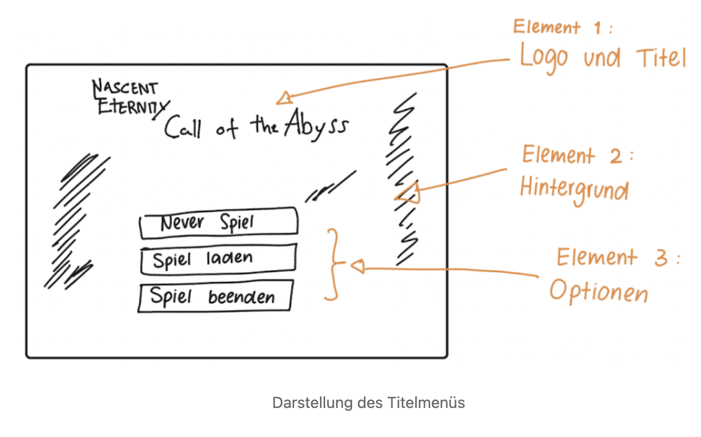

### Element 1 Logo und Titel

Element 1 ist eine einfache Einblendung einer Bilddatei - es ist noch zu klären, ob es sich um eine skalierbare Datei handeln wird oder um eine Binärdatei. Es besteht aus dem Logo des Franchise und dem Titel des Spiels.

### Element 2 Hintergrund

Das Hintergrund besteht aus eingeblendeten Szenen. Die Szenen sind angelehnt an Level aus dem Spiel. Dabei wird in einer gemächlichen Geschwindigkeit die Kamera von oben nach unten durch die Szene bewegt. Jede einzelne Szene wird durch ein ebenfalls gemächliches Fade-to-Black und Fade-in gewechselt.

Es wird noch überlegt, ob ein Filter hinterlegt wird, damit die Objekte des Hintergrunds nicht zu sehr ablenkend ist (Sowas wie ein Grauschleier oder ähnliches).

#### Szenenreihenfolge

| Nr. | Szene                | Ab welchen Zeitpunkt |
|-----|----------------------|----------------------|
| 1   | Wald                 | Immer                |
| 2   | Thronraum            | Immer                |
| 3   | Erstes Dungeon Level | Immer                |

Die Reihenfolge der Szenen ist noch nicht final abgeschossen.

### Element 3 Optionen

Es ist geplant, dass es drei Optionen gibt: 

| Nr. | Option        | Wozu dient die Option   |
|-----|---------------|-------------------------|
| 1   | “Neues Spiel” | Startet ein neues Spiel |
| 2   | “Spiel laden” | Lädt ein neues Spiel    |
| 3   | “Beenden”     | Beendet das Programm    |

::: error
Es ist noch offen, ob es die Option “Option” gibt, wo Optionen wie Sprachauswahl möglich sein können.

:::

# Spielabläufe

**Geplantes Zielbild; teilweise umgesetzt.** Die folgenden Beschreibungen sind Designabsicht. Verfügbare Funktionen und Abweichungen sind im aktuellen Umsetzungsstand ausdrücklich getrennt aufgeführt.

## Interaktionen

Beim Druck auf die Interaktionstaste erscheint der Interaktionsradius (Int-R). Dieser bereitet sich innerhalb einer halben Sekunde ausgehen vom Anführer der Gruppe aus. Der Interaktionsradius ist dabei relativ in der Größe zum Wert der Wahrnehmung des Anführers. Intern wird jedoch auch um den Anführer einen Radius gezogen, der den anderen Charakteren entspricht. So wird auch ermittelt, was die anderen Charakteren wahrnehmen und womit sie interagieren können. Kann ein anderer Charakter mit mehr Sachen interagieren als der Anführer, sagt dieser Charakter mit einer Sprechblase über seinen Kopf, dass er was wahrnehmen kann.

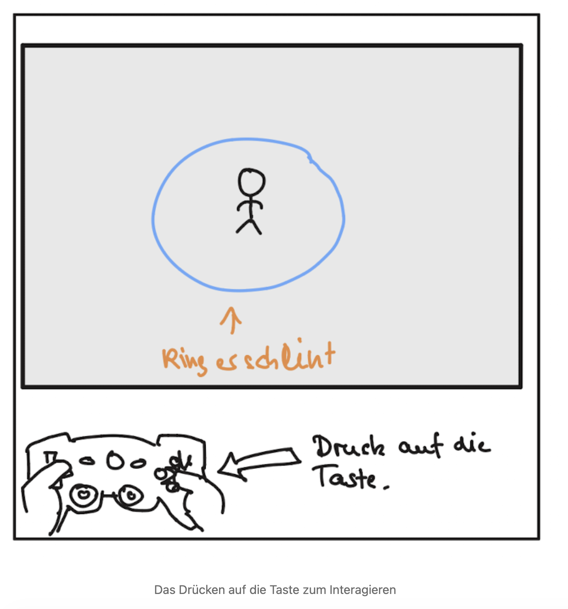

::: info
Während der Aktionsradius aktiv ist, ist die Spielwelt ausgegraut und steht still (alle Animationen werden auch gestoppt).

:::

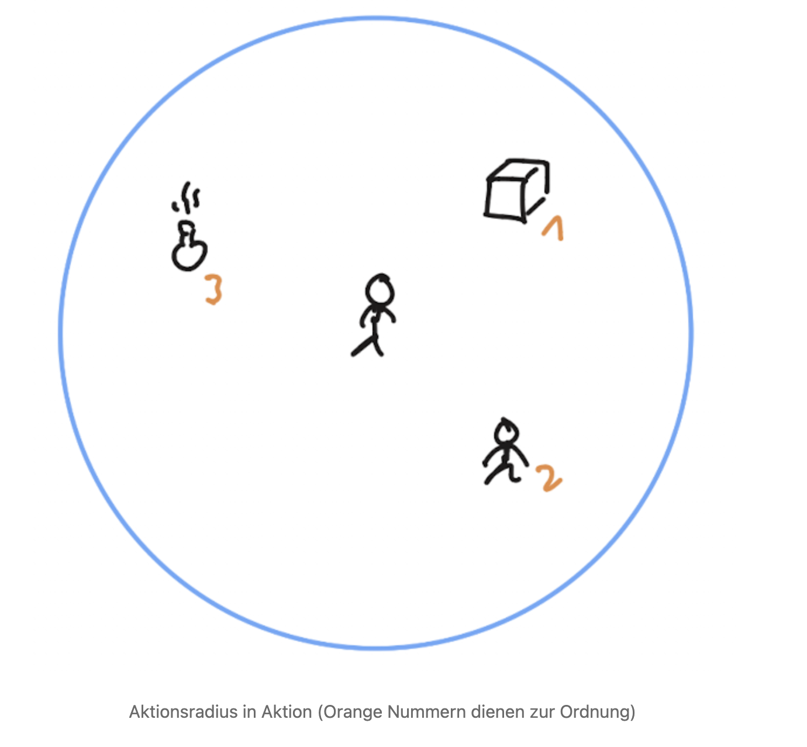

Innerhalb des Interaktionsradius kann mit “Interagierbaren” (NPCs, Gegnern, Objekte und mehr) interagiert werden.

Bei einer Maussteuerung können diese Objekte mit der Maus ausgewählt werden, bei Tastatur oder Gamepad mit den Bewegungstasten.

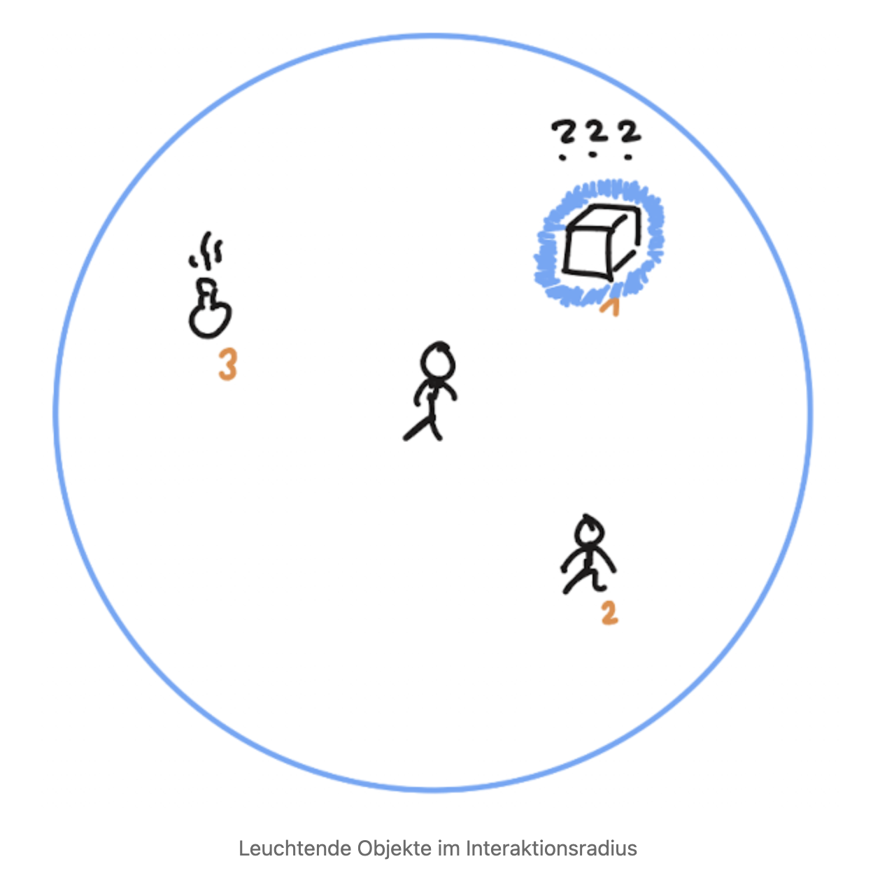

Sobald ein Interagierbares ausgewählt worden ist (mit der Maus mit Linksklick oder mit dem Controller/ Tastatur mit den Bewegungstasten zum “durchklicken”), dann leuchtet die ausgewählte Entität auf und der Name erscheint darüber. Das Leuchten soll in den Optionen später auswählbar sein- so kann es eine Farbe sein oder ein negatives Leuchten sein.

Ist es eine Erst-Interaktion mit dem Objekt oder dem Charakter, ist der Name unbekannt und es erscheinen drei Fragezeichen. Erst-Interaktion bedeutet, wenn der NPC noch nie vorher gesehen worden ist, oder wenn der Typus der Entität nicht bekannt ist (Hat man schon mal einen “Dolch” gesehen, so kann auch jeder andere Dolch erkannt werden, genauso mit bestimmen NPCs wie bestimme Monster oder Tiere).

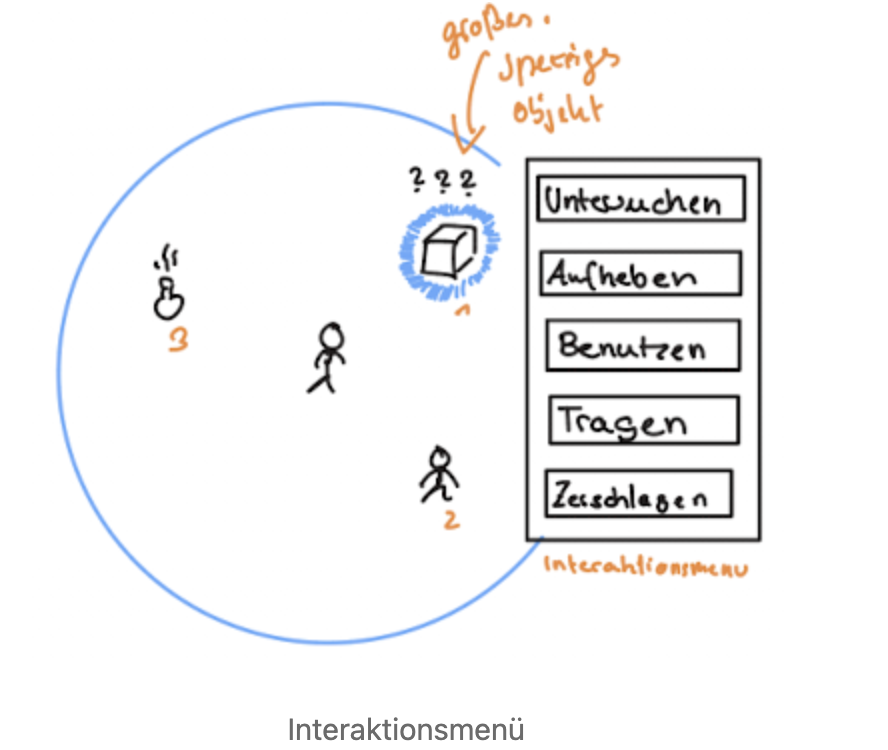

Direkt nach der Auswahl erscheint das Interaktionsmenü (Int-M). Das Int-M hat eine gewisse Anzahl der Optionen. Die genauen Auswahlmöglichkeiten hängen vom Interagierbaren (der Entität) ab. Ist es ein Gegenstand, so kann es untersucht werden, um den Namen festzustellen oder zu gucken, ob es ein besonderer Vertreter des Typs ist und so den Namen herausfinden. Gegenstände kann man auch ins Inventar packen (“Verstauen” hier aufheben genannt, aber der Begriff aufheben ist nicht eindeutig genug). Manche Gegenstände können auch benutzt werden (Bsp. Heiltrank), wenn es sich um ein Gebrauchsgegenstand handelt.

Falls das Gewicht nicht höher ist als die Körperkraft es zulässt (die dazu notwendige Formel muss noch erstellt werden), kann der Anführer den Gegenstand tragen. So gelangt es nicht ins Inventar, sondern der Charakter trägt es in den Händen. Bis es nicht abgelegt worden ist (Dann über das Int-M und dann die Auswahl des eigenen Charakters), kann der Charakter nichts mit den Händen machen. Beginnt so ein Kampf, muss der Charakter den Gegenstand erst hinlegen, was einen Zug kostet.

Zerschlagen zerstört ein Objekt. Man kann aber auch auf andere Weise einen Gegenstand zerstören - mit einem Messer kann man Objekte, die zerschneidbar sind, auch zerschneiden. 

Wichtig ist, dass Objekte in ihren Attributen ihre Interaktionsmöglichkeiten gespeichert haben. Da kann es auch bedingte Interaktionsmöglichkeiten sein, wie 

```
WENN ein Charakter ein Messer hat DANN kann es zerschnitten werden
```

aber auch

```
WENN ein Charakter Körperkraft über 3 hat DANN kann er das Objekt tragen
```

Es können also auch Objekte mit anderen Objekten interagieren. Aber auch mit der Umwelt. Wird ein brennbares Objekt auf einen heissen oder brennenden Boden gestellt, verbrennt es auch und es entsteht zum Beispiel Asche. Andere Objekte können im Wasser Schwimmen, aufweichen oder zu Boden sinken. 

Diese Informationen werden in den Objekten persistiert.

::: warn
Wichtig ist aber auch, dass die Optionen im Int-M nur angezeigt werden, wenn die Bedingungen erfüllt sind.

:::

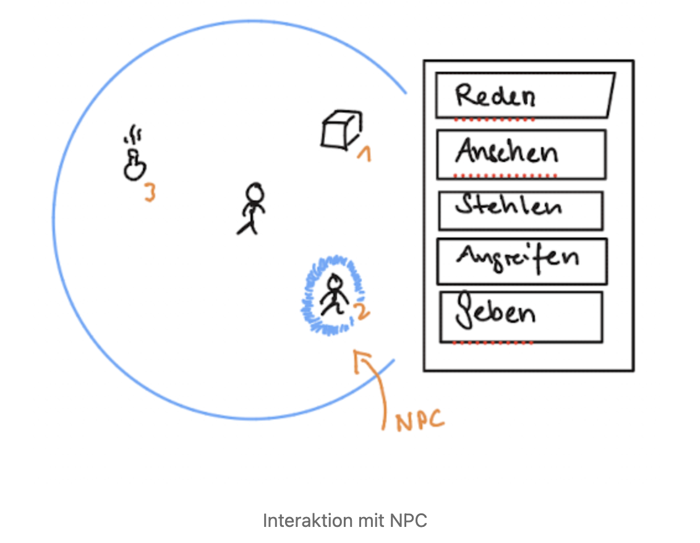

Bei NPCs verhält es sich ähnlich - grundsätzlich unterscheidet es sich in der Logik auch nicht von einem Objekt im Sinne eines Interagierbaren- mit wenigen Ausnahmen. 

So kann man Versuchen, mit jedem NPC zu reden. Ansehen erzeugt eine Beschreibung im Log -den Namen erfährt man jedoch nur im Gespräch. Stehlen ist nur bei Partys verfügbar, in der in Mitglied mindestens einen Punkt im Stehlen hat. Dieser wird eine Probe, unabhängig vom Anführer. 

Angreifen greift den NPC an- jedoch erscheint da dann die Frage, ob man dies auch wirklich machen will. Mit Geben kann man den Charakter ein Objekt geben, dass der Anführer in der Hand hält. 

Zudem können manche NPCs getragen werden. 

Wichtig ist, dass sobald eine Handlungsoption ausgewählt worden ist, dass dann das Int-M geschlossen wird, der Int-R zieht sich zusammen, der Freeze und der Grauschleier der Umwelt hört auf und die ausgewählte Aktion wird ausgeführt.

# Darstellung von Spielefenster

**Teilweise umgesetzt.** Gemeinsame Fenster, Partyreihenfolge, Charakterblätter, Inventare und Cover-Flow-Navigation existieren. Partygröße und Formation sind Ziele; der aktuelle Speichervertrag unterstützt nur Dannerman und Shalka.

Ein Spielefenster ist eine Ansicht für den Spieler, um den verschiedenen Erfordernissen des Spiels Herr zu werden.

## Normaler Spielüberblick

Für meiste Zeit des Spiels sieht der Spieler eine Übersichts des Spielfelds. Hier dargestellt mit Kuben, Zylinder und Strichfiguren. Über jeden Charakter, der der Party angehört ist ein kleines, halb-transparentes Fenster, mit einem Bild und der Anzahl der SP und KP. 

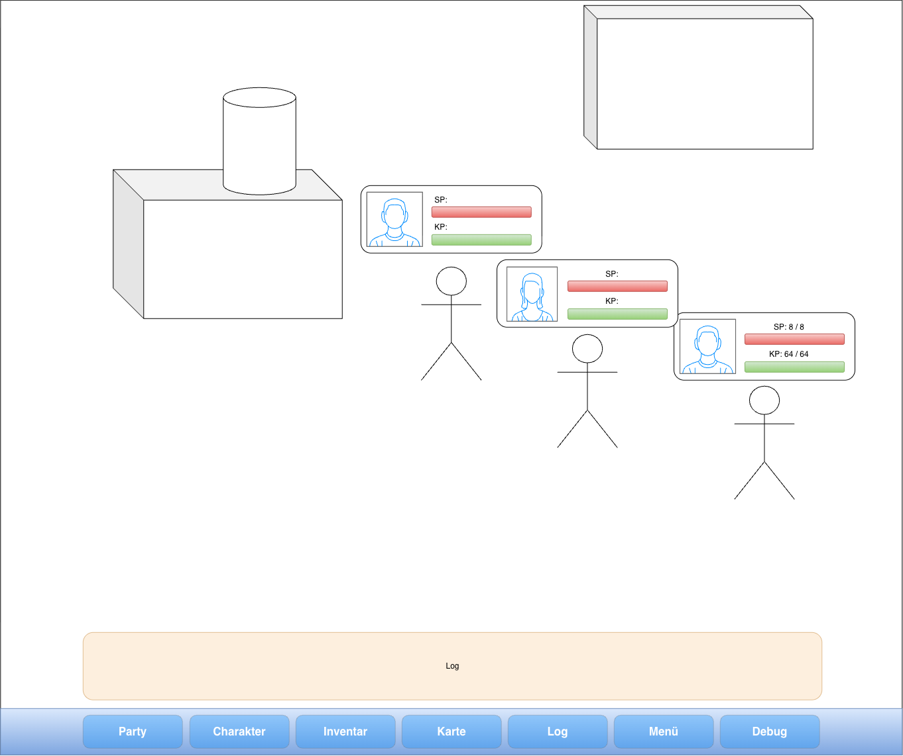

Unten ist das halb-transparente Log-Feld, wo die Nachrichten an den Spieler angezeigt werden. Darunter ist die Spiel-Leiste. Bisher sind die folgende Punkte für die Leiste vorgesehen: 

- Party, zum Sortieren der Party-Reihenfolge (und später zum Einstellen einer Formation)
- Charakter, zum Aufrufen der Charakterblätter
- Inventar, zum Aufrufen des Paperdolls und des Gepäcks
- Karte
- Log
- Menü zum Speichern, laden, Beenden des Spiels und zum Aufruf der Optionen
- und für die Entwicklung ein Debug Menü.

## Grundsätzlicher Aufbau der Fenster

Die Fenster, welche Aufgerufen werden, sind angeordnet als "Cover Flow", was einer derartigen Sicht entspricht:

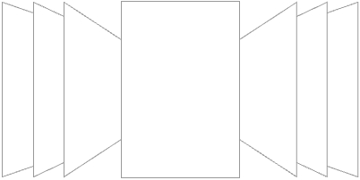

Das jeweilige Fenster, das aufgerufen wurde, wird in der Mitte angezeigt. Links und Rechts davon sind die jeweiligen Fenster der Leiste, wie sie in der Spiel-Leiste aufgelistet werden. 

Die Reihenfolge im Moment ist wie folgt: 

1. Party
2. Charakter
3. Inventar
4. Karte
5. Log
6. Menü
7. Debug 

Ist also das Fenster "Karte" aufgerufen, wird links angeschrägt von Rechts nach links "Inventar", "Charakter" und "Party" angezeigt, und rechts wird von links nach rechts "Log", "Menü" und "Debug" angezeigt. Es wiederholt sich dabei immer wieder, so dass links von "Party" "Debug" oder "Menü" angezeigt. Um die Fenster zu wechseln muss mit der Maus oder oder mit der Tastatur/Controller-Steuerung der Pfeil nach Links oder Rechts ausgewählt werden.

## Party Fenster

Das Partyfenster ist dazu gedacht, den Anführer zu bestimmen und auch die Reihenfolge der Party. 

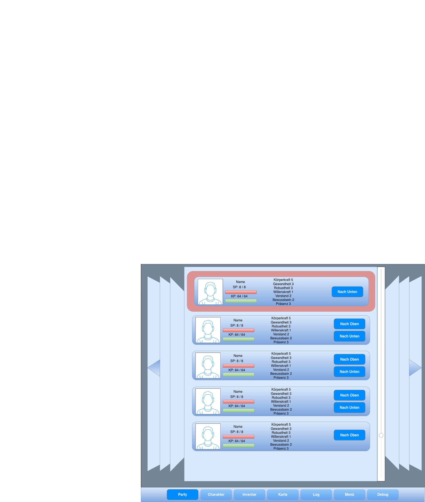

Das Fenster kann bis nach unten gescrollt werden, da die Anzahl an Partymitgliedern nicht beschränkt ist.

## Charakter Fenster

Das Charakterfenster zeigt die Charakterblätter aller Charakter in Reihenfolge, wie sie im Party Fenster festgelegt wurde.

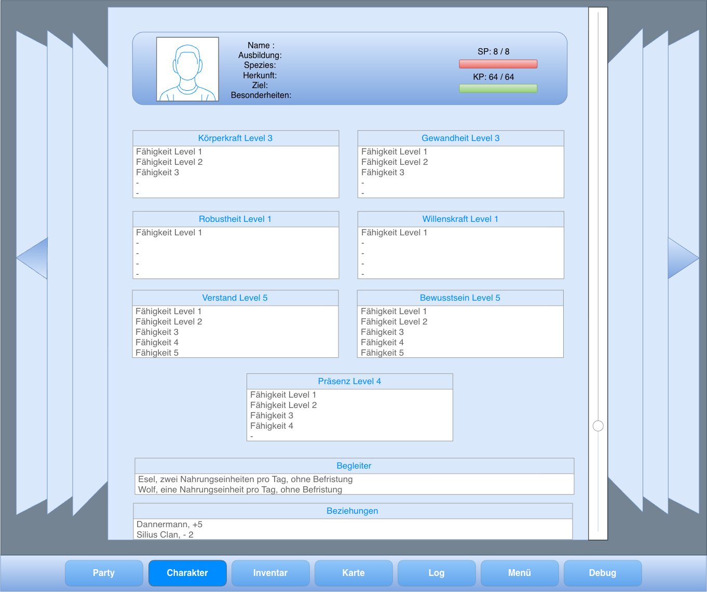

Die Charakterblätter können durchgescrollt werden. Sobald ein Charakterblatt eines Charakters zuende ist, wird das nächste direkt darunter angezeigt.

## Inventar Fenster

Von der Bedienung ist das Inventar-Fenster genauso zu behandeln wie das Charakterfenster. Hier wird jedoch das Inventar angezeigt. Mit Drag und Drop über Maus oder mit einem Aktionsmenü ausgerüstet werden. 

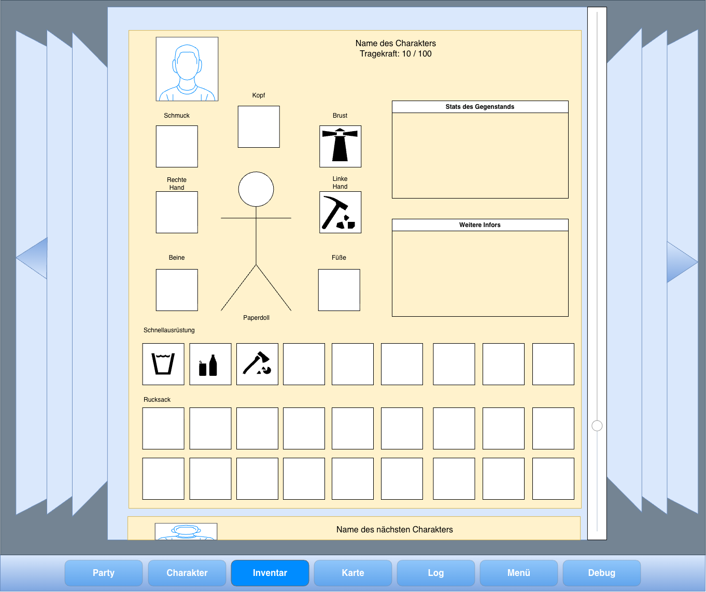

Gegenstände können über Kontextmenü oder über Drag and Drop an andere Charakter weitergegeben werden, da ein Inventar eines Charakters überhalb des Inventars eines anderes Charakters durchgescrollt werden kann.

## Angriffe, Gegenstandseigenschaften und Musik

**Umgesetzt mit ausdrücklich genannten Übergangsregeln.** Die Unterpunkte zu späterer Entwicklung sind weiterhin geplant, keine aktuellen Fähigkeiten.

### Waffenlose Angriffe

Ein Charakter kann auch ohne Gegenstand angreifen. Bei mindestens einer freien Hand erscheint im Kampfmenü die Aktion **Schlag**. Sie ist außerdem über das Fähigkeitenmenü verfügbar.

Die Angriffsstärke berechnet sich aus:

**Effektive Körperkraft + abgerundete Hälfte der Fertigkeitsstufe „Waffenloser Kampf“**

Die effektive Körperkraft enthält weiterhin die vollständigen Attributboni gelernter Fertigkeiten. Nur der zusätzliche, unmittelbar auf den Angriff angerechnete Fertigkeitsbonus wird halbiert.

Beispiele für den zusätzlichen Bonus:

- Fertigkeitsstufe 1: +0
- Fertigkeitsstufe 2 oder 3: +1
- Fertigkeitsstufe 10: +5

### Angriffe mit Gegenständen

Jeder Gegenstand kann als Angriffsgegenstand verwendet werden. Für die Kampfnutzung muss er in einer Hand oder einem Platz der Schnellausrüstung liegen. Gegenstände ohne eigene Angriffsart bieten einen improvisierten Schlag an.

Die Angriffsstärke berechnet sich aus:

**Effektive Körperkraft + Kampfwert des Gegenstands + abgerundete Hälfte der passenden Fertigkeitsstufe**

Jeder Gegenstand besitzt mindestens den **Kampfwert 1**. Fehlt eine passende gelernte Fertigkeit, beträgt der zusätzliche Fertigkeitsbonus 0.

Beim Messer wird die Körperkraftfertigkeit **Kurze Klingen** angerechnet. Gegenstände können unterschiedliche Kampfwerte für ihre Verwendungsarten besitzen. Das Messer verwendet derzeit Kampfwert 6 beim Stechen und Kampfwert 8 beim Werfen.

### Verteidigung, Mindestschaden und Rüstung

Nach Berechnung der Angriffsstärke werden Ausweichen und Schadensminderung durch Robustheit angewendet.

Ein erfolgreicher Treffer mit positiver Angriffsstärke verursacht **mindestens 1 Schaden, wenn die getroffene Stelle ungerüstet ist**. Ein ausgewichener Angriff verursacht weiterhin 0 Schaden.

Bei einer gerüsteten Trefferstelle darf der Schaden vollständig abgefangen werden. Nullschäden bleiben damit ein gewollter Bestandteil des Kampfsystems. Schwachpunkte sollen später Möglichkeiten schaffen, wirksame Angriffe gegen ansonsten gut geschützte Gegner auszuführen.

**Vorläufige Umsetzung:** Trefferzonen werden noch nicht ausgewertet. Sobald mindestens ein ausdrücklich als Rüstung gekennzeichneter Gegenstand an einem Körperplatz getragen wird, gilt vorerst die gesamte Figur als gerüstet. Normale Kleidung sowie Rüstung im Rucksack oder in der Schnellausrüstung zählen nicht automatisch als angelegte Rüstung.

Die Rüstungskennzeichnung gewährt derzeit keinen zusätzlichen eigenen Schadensminderungswert. Sie entscheidet zunächst darüber, ob der Mindestschaden gilt. Die ortsbezogene Prüfung wird mit Trefferzonen und Schwachpunkten ergänzt.

### Inventaranzeige und Gegenstandsbruch

Ein Kampfwert von 1 wird in den Gegenstandseigenschaften nicht angezeigt. Höhere Kampfwerte und unterschiedliche Werte einzelner Verwendungsarten werden ausgewiesen.

Für jeden Gegenstand kann eine **Bruchchance zwischen 0 und 100 Prozent** festgelegt werden. Standardmäßig beträgt sie 0 Prozent.

Die Bruchchance wird einmal nach einem ausgeführten Gegenstandsangriff geprüft, auch wenn das Ziel ausgewichen ist. Wird kein gültiges Ziel angegriffen, findet keine Bruchprüfung statt.

Zerbricht ein Gegenstand, wird das verwendete Exemplar aus dem Ausrüstungsplatz entfernt. Gleichartige Gegenstände im Rucksack bleiben erhalten. Geworfene oder anderweitig verbrauchte Gegenstände werden nicht zusätzlich auf Bruch geprüft.

Damit lassen sich beispielsweise Glasflaschen als verwendbare, aber zerbrechliche Angriffsgegenstände definieren.

### Levelmusik

Für jedes Level werden ein Musikstück und dessen Wiedergabeverhalten festgelegt: einmalige Wiedergabe oder fortlaufende Wiederholung.

Die beiden derzeit verfügbaren Level, **Level1Ep1** und **MonsterLair-Level1**, verwenden **itcc.mp3** im Loop. Beim Betreten eines neuen Levels beginnt dessen Musik bei Position 0.

### Kampfmusik und Gegnerkategorien

Gegner erhalten eine Musikkategorie: **Normal, Boss, Superboss oder Final**. Jeder Kategorie kann ein eigenes Kampfmusikstück zugeordnet werden. Bei mehreren Gegnern bestimmt die höchste Kategorie das Musikstück.

Aktuell verwenden alle Kategorien vorläufig **boss_battle.mp3**. Kampfmusik läuft im Loop. Wird dasselbe Stück weiterhin benötigt, startet es bei einem Kategorie- oder Lautstärkewechsel nicht erneut.

Beim Kampfbeginn wird die Levelmusik ausgeblendet und an ihrer aktuellen Abspielposition pausiert. Die Kampfmusik wird eingeblendet.

Sind sämtliche betreffenden Gegner tot, besiegt oder erfolgreich geflüchtet, setzt die Levelmusik an ihrer unterbrochenen Position fort.

### Musik nach eigener Flucht

Die Flucht der Party beendet die Kampfmusik nicht, solange ein beteiligter Gegner als Bedrohung im Level verbleibt. Ohne aktiven Kampf läuft sie leiser weiter; die Levelmusik bleibt pausiert.

Verlässt die Party das Level, endet die bisherige Kampfmusik und die Musik des neuen Levels übernimmt.

Musikwechsel erfolgen mit einer kurzen Überblendung, derzeit **0,35 Sekunden**. Die vorläufigen Lautstärken betragen **−6 dB** für Levelmusik und aktive Kampfmusik sowie **−14 dB** für weiterlaufende Kampfmusik nach eigener Flucht.

Abspielpositionen und verbleibende Musikbedrohungen werden derzeit nicht im Spielstand gespeichert.

### Weitere Entwicklung und Balanceprüfung

Schwachpunkte, Trefferzonen, Angriffsradien und die stärkere Einbindung von Bewegung werden später ergänzt.

Eine feste Zielvorgabe für die Kampflänge ist noch nicht beschlossen. Stärkevorräte und Angriffswerte werden deshalb vorerst nicht auf eine bestimmte Trefferzahl abgestimmt.

Weitere taktische Angriffsarten sollen über Fähigkeiten und Fertigkeiten gestaltet werden. Dafür werden derzeit noch keine neuen Mechaniken festgelegt.

Die textuelle Kampfsimulation im Hauptmenü dient zur Prüfung der aktuellen Regeln. Sie erlaubt einstellbare Charaktere, einzelne Kampfschritte und Serienvergleiche. Räumliche Faktoren und zukünftige Schwachpunktregeln sind darin noch nicht enthalten.

# Aktueller Umsetzungsstand

Dieser Abschnitt beschreibt den Code vom 30. Oktober 2026 einschließlich der
laufenden lokalen Änderungen. Bei Abweichungen bleibt das vorstehende Zielbild
als **Planung** erhalten; es wird nicht als bereits verfügbare Funktion ausgegeben.

## Überblick

| Bereich | Status | Tatsächlich vorhanden / Grenze |
|---|---|---|
| Spielwelt | Umgesetzt | 3D-Physik mit 2.5D-Darstellung, zwei Prototyplevel; keine vollständige Kampagne |
| Charakterdaten | Teilweise umgesetzt | gemeinsame Resources/IDs, Attribute, Talente; Merkmalsmodifikatoren und reguläre Charaktererschaffung fehlen |
| Entwicklung | Teilweise umgesetzt | XP-Methoden/Training vorhanden; kein vollständiger Lehrer-/Aktions-XP-Ablauf |
| Party | Teilweise umgesetzt | Dannerman und Shalka können beide führen; Rekrutierung/Formation fehlen |
| Interaktion | Teilweise umgesetzt | Radius, Aktionen und Hervorhebung; kein allgemeines Wahrnehmungs-/Materialsystem |
| Dialog/Wissen | Teilweise umgesetzt | Dialogue Manager, eigene UI und figurenspezifisches Wissen; kein allgemeines Ermittlungsframework |
| Inventar/Handel/Diebstahl | Umgesetzt mit Grenzen | geprüfte Transfers und Händlerbestände; kein allgemeiner Rückkauf |
| Kampf | Teilweise umgesetzt | Initiative, Gegenstände, Schaden, Bewegung, reale Fluchtwege; Statussystem, Trefferzonen und Recovery fehlen |
| Quest | Teilweise umgesetzt | geprüfter Banditenablauf; keine universelle Questzustandsmaschine |
| Speichern/Laden | Teilweise umgesetzt | manuelle Saves, Validierung/Migration, Weltaufbau; bekannte Fehler im Levelwechseltest |
| Spielefenster/Karte | Umgesetzt mit Grenzen | Cover Flow, Inventare, Kartenerkundung; Karte ohne Sichtprüfung/Stockwerkstrennung |
| Grafik/Musik | Umgesetzt | Qualitätsstufen, 3D-Auflösung, Level-/Kampfmusik; FPS-Gewinn einfacher Stufe nicht gemessen |
| Sequence-System | Teilweise umgesetzt | MVP mit wait/set/end/abort; weitergehende Regie und Resume geplant |
| JSON-Charakterregeln | Geplant | 32 Entwurfsdateien vorhanden; kein Importer, keine Spielwirkung |
| Releaseplattformen | Geplant | Exportpresets sind kein Nachweis veröffentlichter oder abgenommener Builds |

## Architektur und gemeinsame Weltregeln

**Umgesetzt.** `MainGame` ist der Spielanker. Systeme leben unter
`MainGame/Systems`, Level unter `World/LevelRoot`, die Party unter
`World/EntityRoot`. `src/core`, `gameplay`, `world`, `resources`, `ui` und `debug`
bleiben die vorhandenen Zuständigkeitsbereiche. Der Projektname begründet keine
2D-Physikarchitektur. `project.godot` verwendet Godot 4.7 / Forward+; die zuletzt
verwendete vollständige Installation ist Godot 4.7.2 Mono. Dialogue Manager
3.10.5, Terrain3D und das projekteigene Sequence-Exportplugin sind aktiviert.

`GameState.world_state` ist der autoritative Sitzungszustand ohne Node-Referenzen:
Charaktere, Flags, Orte, Objekte, Platzierungen, Party, Händler, Quests,
Kartenerkundung, Wissen und Ereignisse. `CharacterRegistry` verbindet stabile
Character-IDs mit Vorlagen und Laufzeitdaten. Actor-Nodes verkörpern diese Daten;
sie bilden keine zweite unabhängige Charakterbuchhaltung. Inventarbesitz liegt
in `CharacterResource.inventory`. Entfernte eindeutige Weltobjekte bleiben entfernt.

`GameState.meets_condition`, `apply_effects` und `apply_effects_if` verwenden
`WorldRules`. Unbekannte Operationen und ungültige Parameter werden abgelehnt.
Effektfolgen prüfen Arbeitskopien und übernehmen Wissen, Flags, Gold, Beziehungen,
Inventare, Händlerbestand und Ereignisse erst nach erfolgreicher Gesamtprüfung.
Direkte Legacy-Schreibzugriffe sind nicht automatisch Teil dieses Vertrags.

| Umgesetzte Bedingungen | Umgesetzte Effekte |
|---|---|
| `flag_equals`, `knows_fact` | `set_flag`, `learn_fact`, `forget_fact` |
| `relationship_at_least`, `has_item` | `change_relationship`, `change_gold` |
| `quest_state` für Banditenquest, `event_occurred` | `start_quest`, `complete_quest` |
| | `transfer_item`, `remove_item`, `steal_item`, `shop_buy`, `shop_sell` |

Wissen gehört einer bestimmten Figur; Registryexistenz bedeutet keine aktive
Partymitgliedschaft. Persistente Weltereignisse besitzen fortlaufende IDs, Typ
und Nutzdaten, aber keine Simulationsuhr. Niederlage, Questabschluss, Transfer,
Diebstahl, Entfernung, Kauf und Verkauf sind angeschlossen. Laden spielt sie
nicht erneut ab. Das sichtbare `EventLog` ist davon getrennt.

**Verbindliche Architektur:** vorhandene Systeme erweitern; keine parallelen
Charakter-, Kampf-, Dialog- oder Speichersysteme einführen. Eingabesperren haben
Besitzer: `acquire_input_lease(owner)` liefert einen Token, nur der eigene Token
wird mit `release_input_lease(token)` freigegeben. Legacy-Lock-Zähler existieren
daneben. Abbruch, Fehler und Szenenabbau bereinigen eigene Handles/Signals/Zustände.

## Charakterregeln: Ist-Stand und Abweichungen vom Ziel

**Teilweise umgesetzt.** `CharacterResource` enthält ID/Name, Ausbildung,
Spezies, Herkunft, Ziel, Besonderheiten, sieben Basisattribute, Talente/XP,
Training, aktuelle Punkte, Fraktionen/Beziehungen, Gold, Inventar und Niederlagestatus.
Persönliches Ziel ist Text ohne unmittelbaren mechanischen Effekt.

Auswahlwerte existieren für Ausbildung (keine/Krieger/Gelehrter/Handwerker),
Spezies (keine/Mensch/Elf/Zwerg), Herkunft (keine/Waise/adelig/bürgerlich) und
Besonderheiten (keine/mutig/feinfühlig/geduldig). Sie erzeugen noch keine
automatischen Boni, Mali, Talentpakete oder Caps. Die Konstante „zwei
Besonderheiten“ wird nicht allgemein als Aufnahmegrenze durchgesetzt.

| Regel | Umgesetzt | Geplant bzw. offen |
|---|---|---|
| Attribute | `max(0, Basis + Summe zugeordneter Talentstufen)`; Vorlagen haben Basiswerte | Wertebildung aus Merkmalen, Umstands-/Statusmodifikatoren |
| SP-Basis | Körperkraft + Gewandheit + 2 × Robustheit | schnelle Regeneration und besondere Heilung negativer Verletzungen |
| KP-Basis | Verstand + Willenskraft + 2 × Bewusstsein | regulärer KP-Verbrauch bis zur negativen Basis |
| Tod | aktuelle SP ≤ negative SP-Basis; 0 SP ist keine automatische Bewusstlosigkeit | Wiederbelebung, Recovery, endgültige Folgen |
| Kosten/Heilung | positive KP-Kosten brauchen ausreichenden Vorrat; Heilung/KP-Wiederherstellung ohne Basisobergrenze | Heilungslimit, Regeneration, Erschöpfungsregeln |
| Talentstufe | 100 XP je Stufe, +1 auf zugehöriges Attribut | automatisches Lernen durch Handlungen/Lehrer |
| Talentcap | Standard 10 + `skill_level_cap_bonus` | Designziel 20 mit Merkmalsabhängigkeit |
| Training | höchstens fünf aktive Talente; Aktions-XP nur für markierte Talente | vollständiger regulärer Lernablauf; Kampf vergibt nicht automatisch Aktions-XP |
| Talentplätze | fünf sichtbare Plätze je Attribut | einheitliche Durchsetzung durch alle Lernmethoden |
| Tragkraft | `10 + 5 × effektive Körperkraft`; Gewicht aus Rucksack und Ausrüstung | 0–10-Gewichtsmodell, Händetragen und Überlastfolgen |

Beim Talentaufstieg erhöhen sich positive aktuelle SP/KP jeweils um 1 bis zur
neuen Basis; 0/negative Werte werden nicht aufgefüllt. Der freie XP-Pfad ist
noch keine verlässliche fertige Spielerregel: Er verwendet zurückgegebene
Rest-XP als Wahrheitswert und kann den freien Vorrat falsch abbuchen.

**Aktuelle Vorlagen:** Dannerman hat Basisattribute 3/2/2/2/2/2/3, Shalka
2/3/2/2/2/3/2 (Körperkraft, Gewandheit, Robustheit, Willenskraft, Verstand,
Bewusstsein, Präsenz). Talentboni ergeben SP/KP/Tragkraft 12/10/40 bzw. 11/12/20.
Dannerman startet mit 50 Gold, 50 freien XP und einem Messer im Rucksack,
Shalka mit 20 Gold. Spielstände können abweichen. Portrait/Paperdoll verwenden
`assets/characters/<name>/<name>_portrait.png` bzw. `<name>_paperdoll.png`.

Beziehungen sind gerichtet, auf −10 bis +10 begrenzt. Persönliche Einträge gehen
Fraktionswerten vor; unter passenden Fraktionswerten gewinnt der größte absolute
Betrag. Soziale Talente allein sind keine allgemeine Überredenprobe. Befristete
Begleiterverträge, Bedürfnisse/Ängste, Gerüchte, Tagesabläufe, zeitabhängige
Anwesenheit und ein vollständiges Buch der Charaktere sind noch nicht umgesetzt.

## Steuerung, Interaktionen und Transaktionen

**Teilweise umgesetzt.** WASD, Shift-Sprint, Leertaste-Sprung, Linksklick bzw.
gehaltener Linksklick zur Mausbewegung, E/Rechtsklick für Interaktion, I/C für
Inventar/Charakter und F für Partyfähigkeiten sind vorhanden. Standard-UI-Fokus,
Bestätigung/Abbruch und Fensterwechsel per Q/E bzw. Schultertasten existieren.
Vollständige Bedienbarkeit sämtlicher Abläufe allein mit Controller oder
Pfeiltasten wird damit nicht als abgeschlossen behauptet.

3D-Bewegung nutzt Kollision, Gravitation, Sprung und Stufenhilfe. `StateWalk`
verwendet Gehen 1,5, Sprint 3,75, Beschleunigung 6 und Abbremsen 9.
Begleiter folgen direkt dem Leader, keiner allgemeinen Formationskette.

Das Aktionsmenü sucht `interactable`-Nodes im horizontalen Radius 1,5 um den
Leader, zeigt deren verfügbare Aktionen, Radius und temporäre Hervorhebung.
Es stoppt den handelnden Charakter, aber nicht allgemein Welt und Animationen.
Wahrnehmungsabhängige Radien, Hinweise weiterer Partymitglieder, unbekannte
Namen mit „???“, Grauschleier/Freeze, frei wählbare Highlightstile und ein
allgemeiner Materialsimulator bleiben Ziele des vorstehenden Interaktionsdesigns.

Konkrete Abläufe existieren für Aufnahme/Verwendung, NPC-Gespräch, Handel,
Übergabe, Diebstahl, Angriff und Pflanzen schneiden mit bereitgehaltenem Messer.
Händetragen, NPCs tragen, Ablagezug im Kampf und allgemeine Brennen-/Asche-/
Wasserreaktionen sind nicht aus diesen Einzelbeispielen abzuleiten.

**Diebstahl umgesetzt:** `clamp(0,5 + 0,04 × (Gewandheit Dieb − Bewusstsein Opfer),
0,05, 0,9)`. Erfolg überträgt ein Rucksackstück; Ausrüstung gehört nicht zum
Angebot. Vorprüfungsfehler wie fehlender Bestand/Übergewicht sind keine
Entdeckungswürfe. Ein misslungener Wurf startet Kampf mit dem Opfer als Angreifer.
Die geplante Voraussetzung Stehlen ≥ 1 ist nicht mit dieser vorhandenen Formel
gleichzusetzen.

**Handel umgesetzt:** Ein Klick bewegt eine Einheit. Gold, Bestand, Inventar,
Besitzer und Traglast werden gemeinsam geprüft. Bestand −1 ist unbegrenzt.
Verkäufe füllen das Angebot nicht auf. Nicht gelistete Typen verwenden den
Ersatzpreis `max(1, int(weight × 10))`; Rückkauf ist keine fertige Regel.

## Party, Inventare und Fenster

**Umgesetzt mit Grenzen.** `GameWindows` unter `UI/MenuRoot` zeigt die sieben
zyklischen Seiten in der beschriebenen Reihenfolge. Seitenkarten tragen Titel,
keine eigenen Live-Renderings. Mitte und eingebettete CharacterSheetUI-/InventoryUI-/
MapUI-Inhalte werden gemeinsam verwaltet; Seitenwechsel räumen Views/Signale auf.
Die Fenster sperren Weltsteuerung mit einer eigenen Lease, pausieren aber nicht
die Simulation. Speichern/Laden und Debug übernehmen nach Schließen ihre Sperre.

Dannerman und Shalka können beide Anführer werden. Platz 1 bestimmt Leader,
Follower, Kamera, HUD und gespeicherte Reihenfolge, ohne Nodes zu ersetzen.
Kampf, Pause, fremde Sperren und tote Leaderkandidaten verhindern Wechsel.
Gespeichert sind `leader_id` und geordnete `member_ids`. Rekrutierung/Entlassung
und Formation fehlen. Die scrollbare UI hat keine allgemeine feste Mitgliederzahl;
der aktuelle Speichervertrag akzeptiert jedoch nur Dannerman/Shalka.

Inventarplätze sind Kopf, Rumpf, rechte Hand (`primaer_hand`), linke Hand
(`nebenhand`), Beine, Füße, Schmuck und neun `guertel_*`-Schnellplätze.
Es gibt keinen zusätzlichen Waffenplatz. Körperplätze prüfen Itemzuordnung und
schließen Verbrauchsgegenstände aus; Hände/Schnellplätze nehmen beliebige Items
auf. Je Platz ein Exemplar, Rucksackstapel gemäß jeweiliger Stapelgrenze.

Aktionsmenü und Drag-and-drop ermöglichen Ausrüsten, Tauschen, Verstauen,
Verwenden, Ablegen und Übergaben zwischen Partyrucksäcken. Übergabe bewegt ein
Stück mit Besitzer-/Traglastprüfung. Verdrängte Items werden nötigenfalls verstaut.
Eigenschaften ausgerüsteter Items sind ohne Ablegen sichtbar. „Weitere Infos“
bleibt leer. Weltpanels zeigen Portrait/SP/KP und weichen bei Überlappung aus.

**Karte umgesetzt:** vereinfachte X/Z-Meshumrisse, Zoom/Ziehen/Übersicht.
Alle 0,2 Sekunden werden Zellen von 2 Welteinheiten im Radius 8 um den Leader
entdeckt, auch bei geschlossener Karte. Wände blockieren das nicht. NPC-/
Objektmarkierungen behalten außerhalb des Radius die letzte bekannte Position;
entfernte Weltobjekte verschwinden. Stockwerke werden übereinander projiziert;
Terrain3D, CSG und Spritegeometrie werden nicht kartografiert. Statische
Geometrie wird beim Levelaufbau erfasst.

**Log/Optionen umgesetzt:** `EventLog` hält bis zu 100 sichtbare Textzeilen für
neu geöffnete Ansichten. Kampf, Dialog und Aufnahme sind angeschlossen; dies
ersetzt keine persistente Ereignishistorie. Lautstärke je Audiobus gilt für die
Sitzung. Grafikpräferenzen sind lokal persistent; eine allgemeine persistente
Sprach-/Audio-/Steuerungsverwaltung ist offen.

## Kampfablauf ergänzend zu den Schadensregeln

**Umgesetzt.** CombatManager/CombatSession führen einen zentralen Kampf in der
normalen 3D-Welt. Ein Angriff prüft reaktionsfähige Figuren im Radius 8 um den
Angreifer. Späteres Heranlaufen allein ist keine allgemeine laufende Rekrutierung.
Positive Beziehung zum Opfer unterstützt es bei mindestens gleich hoher Sympathie
wie zum Angreifer; sonst gewinnt höhere positive Sympathie zum Angreifer.
Partyzugehörigkeit ist Auffangregel ohne eindeutige soziale Zuordnung.
Negative Beziehungen allein erzwingen keinen Beitritt. Partyfiguren können
aufgrund der Beziehungen auf unterschiedlichen Seiten landen.

Initiative startet bei 0, wächst um `effektive Gewandheit × 6` pro Sekunde und
reiht bei 100 einen Zug ein, wobei 100 abgezogen werden. Aktive und bereits
wartende Figuren sammeln nicht weiter; andere auch während der Menüwahl.
Ein aktiver Zug, Gleichstände nach Teilnehmerreihenfolge; Gewandheit 0 sammelt
nichts. Ein Rundensignal ist keine angeschlossene Regeneration/Statusdauer.
Alle Partyfiguren werden im eigenen Zug manuell bedient, echte NPCs automatisch.

Aktionen: Schlag bei freier Hand, Gegenstand, Fähigkeit, Bewegung, Reden, Flucht.
Ausgelöste Aktionen können auch bei Fehlschlag den Zug verbrauchen;
Zurücknavigation nicht. Nur Hände/Schnellplätze liefern Kampfgegenstände.
Zwei belegte Hände erzeugen keinen Doppelangriff. Bewegung ist freie Positionierung
im Kreis `max(1, Gewandheit × 1)` um den Ausgangsort, Tempo 1. Das ist ein
Abstandslimit, keine aufsummierte Wegstrecke. Bestätigen kostet den Zug,
Abbrechen stellt die Ausgangsposition ohne Zugverbrauch wieder her.

Sichtprüfung blockiert passende Angriffe durch Wände oder andere Körper.
Numerische Nahkampf-/Wurf-/Magiedistanzen sind noch nicht ausgewertet.
Reden ruft NPC-Interaktion auf; Überzeugen/Kapitulation/Friedensschluss brauchen
konkrete Regeln. Die NPC-KI wählt ein sichtbares Ziel mit negativster eigener
Beziehung, ersten Kampfgegenstand/erste Verwendung, sonst Schlag. Keine
allgemeine KI-Planung für Bewegung, Flucht, Heilung oder Fähigkeitskombinationen.

Genauigkeit kommt vom Attribut der Verwendung bzw. Quelltalent der Fähigkeit.
Ausweichen = `clamp(0,03 × (Ziel-Gewandheit − Genauigkeit), 0, 0,6)`.
Danach mindert Robustheit den Schaden gemäß den oben beschriebenen aktuellen
Mindestschadens-/Rüstungsregeln. Beim Messer ist Genauigkeit Gewandheit, obwohl
Rohstärke Körperkraft verwendet. Feste Schadensmagie behält ihr `power`.

Aktuelle Itemkampfwerte: Messer 6/8 für Stechen/Werfen, Stein 4/5 für Schlagen/
Werfen. Fehlen Verwendungen, wird improvisiert geschlagen. Wurf/Verbrauch
entfernt das gewählte ausgerüstete Exemplar; Projektilbergung fehlt.
Verbrauch wirkt auf ein aktives Ziel derselben Seite ohne eigenen Distanz-/
Sichtcheck. Heiltrank: 25 SP, keine Basisobergrenze; ausgeschiedene Ziele sind
nicht wählbar.

Schlag ist kostenlos; Feuerstoß verlangt Magiekunde 1, kostet 8 KP, Stärke 14.
Schaden/Heilung sind implementierte Effekte, aber im Katalog fehlt eine aktive
Heilfähigkeit. Schlachtruf ist eine Definition für Bardenkunst 1 und 6 KP;
BUFF/DEBUFF/UTILITY melden `effect_not_implemented`. Der vorhandene Pfad kann
Kosten schon vor dieser Ablehnung abziehen. Das ist keine fertige Buff-Regel.
Partyfähigkeiten unterstützen intern Heilung; offensive Fähigkeiten gegen
Fremde können vor regulärer Initiative als Erstschlag Kampf eröffnen.

Fluchtchance = `clamp(0,5 + 0,02 × (eigene Gewandheit − mittlere aktive
Gegner-Gewandheit), 0,1, 0,9)`. Ein Wurf allein genügt nicht: freier Platz im
passenden Fluchtbereich und begehbarer Weg sind nötig. Die Figur läuft tatsächlich
dorthin; kein Teleport. Unterbrechung kann Flucht aufheben. Fliehende/Entkommene
erhalten keine Züge und sind keine regulären Ziele. Ein einzelner Entkommener
bekommt erst nach Sitzungsende freie Steuerung; erneuter Angriff kann ihn aufnehmen.

Positiver Schaden an der Todesgrenze meldet Niederlage; NPC-Interaktion kann sie
persistent markieren. Heilung hebt die Niederlagemarkierung nicht auf.
Die Sitzung endet bei einer leeren aktiven Seite und noch aktiver Gegenseite.
Beidseitiger Ausfall, Party-Game-over/Recovery, allgemeine Beute und Sieg-XP
sind nicht vollständig geregelt. Flucht ist kein NPC-Niederlageereignis.

Die isolierte Textsimulation nutzt Kopien und die vorhandenen Session-/Resolver-
Regeln, verändert weder Registry/Vorlagen/Welt noch globale Zufallsfolge.
Einzelzug, Einzelkampf und Serien mit 1–500 Kämpfen sind reproduzierbar per Seed.
Talentstufen bis 30 dienen Experimenten. Freie Sicht wird vorausgesetzt; keine
Geometrie, Bewegung, Flucht, Heilstrategie oder Denkzeit. Zeitraster 0,05 Sekunden,
Limit 300 Aktionen/600 simulierte Sekunden. Bei Gleichstand ist A zuerst;
Serien beseitigen diesen Vorteil nicht automatisch.

## Dialoge, Wissen und Banditenquest

**Teilweise umgesetzt.** Dialogue Manager bleibt hinter DialogueSystem und der
projekteigenen Gesprächsoberfläche. `player` wird ausdrücklich als Gesprächskontext
übergeben. Themen, Mutationen, Kamera und Log sind angebunden. Texttempo (Langsam/Normal/Schnell/Sofort) und optionaler Sprechton sind lokal einstellbar; auch gewählte Party-Antworten werden eingetickert. `CharacterResource.voice` steuert die Tonhöhe. Save-Version 11 ergänzt Voice mit Migration älterer Charakterdaten auf 1,0. Definierte Fakten
sind nicht automatisch allen Figuren bekannt. Ein universelles Ermittlungs-/
Puzzleframework mit Beschuldigung, Gerüchten oder Wahrheitseinstufung existiert nicht.

Die Banditenquest besitzt `not_started`, `active`, `ready`, `completed`.
Annahme führt zu active, bestätigte Banditenniederlage zu ready, geprüfte Abgabe
zu completed. Sieg vor Annahme ist erlaubt; späte Annahme setzt ready nicht zurück.
Abschluss/Belohnung erfolgen einmalig und gemeinsam. Alte Flags bilden eine
monotone Kompatibilitätsbrücke. Migration erzeugt keine rückwirkenden Belohnungen
oder Ereignisse. Beliebige Quest-IDs erhalten nicht automatisch diesen Ablauf.

**Offen:** weitere konkrete Quest, mehrere Ziele/Reihenfolge/Alternativen,
Abbruch, Fehlschlag, Wiederholbarkeit und Umgang mit Questgegenständen.

## Speichern, Laden und Levelwechsel

**Umgesetzt mit bekannten Grenzen.** `WorldSaveStore.VERSION` ist **11**.
Writer/Reader, Typ-/ID-Prüfung und Migration bilden einen Vertrag. Schreiben:
temporäre Datei, Prüfung, Ersetzen; maximale Dateigröße 8 MiB.

| Schemaeinführung | Inhalt |
|---|---|
| 4 | Händlerbestände |
| 5 | persistente Weltereignisse |
| 6 | Banditenquestzustand |
| 7 | aktive Party/Reihenfolge |
| 8 | Kartenerkundung |
| 9 | Itemkampfwert, Talent-ID, Bruchchance |
| 10 | explizite Rüstungskennzeichnung |
| 11 | Charakterstimme `voice`, ältere Spielstände erhalten 1,0 |

Unterstützte Altstände werden mit definierten Standardwerten übernommen;
Versionen 1–7 starten ohne entdeckte Karte, alte Items ohne Rüstungsfeld mit false.
Unbekannte Zukunftsversionen/beschädigte Daten werden abgelehnt. Gespeicherte
Händlerangebote übernehmen geänderte Vorlagen nicht automatisch.

`GameState.load_game(path)` prüft einen Kandidaten vor dem Szenentausch und baut
dessen Welt auf. Datei-/Versionsfehler erhalten die Sitzung; erkennbare Aufbaufehler
können die vorherige Welt restaurieren. Kampf, Pause, Interaktion und paralleles
Laden sperren den Einstieg. Haupt-/Spielmenü teilen SaveLoadMenu: neue manuelle
Dateien unter `user://saves/`, auch bei gleichem Namen, Suche, Seiten, Bestätigung
und Fehleranzeige. Autosave/Löschen/Umbenennen/Überschreiben über UI sind offen.

Nicht gespeichert werden aktive Kämpfe/Dialoge, laufende Coroutines/Signals,
UI-Zustände, Physikgeschwindigkeit, Musikposition/Bedrohungen und Simulationsuhr.
Sequence-Flags sind speicherbar, aktive Sequence-Cursor nicht.

Ausgangs-Areas verbinden Level1Ep1 und MonsterLair-Level1 mit Ziel-/Arrivalprüfung
und Fade. Nur der Leader löst aus; nach Aufbau muss er zuerst außerhalb des
Ausgangs gewesen sein. Übergang führt die Party am Ziel zusammen; normales Laden
behält gespeicherte Positionen. Die alte Zusage vollständig getrennter
Banditenidentitäten wird nicht übernommen: Die Höhlenszene hat keine eigene
Gegner-ID-Override. Der aktuelle Levelwechseltest meldet sechs Fehler bei Identität
und Speichern/Laden; unter Windows fehlen außerdem seine `/tmp`-Speicherpfade.

## Kamera, Grafikoptionen und Audio

**Umgesetzt.** CameraSystem besitzt die Weltkamera: Leader-Follow, schräger
Blick, Look-Ahead, Glättung, Zoom, Levelgrenzen, Dialogshots und Kampforbit/-schnitte.
Standard: Abstand 8, Höhe 6, Pitch −45°, Glättung 5, Vorausschau 3.
Charaktere stellen Marker, keine zusätzlichen Weltkameras bereit.

Dialogmarker: Close/Medium/Wide/Profile/OverShoulder unter DialogueCameraPoints;
Eyes/Head/Mouth unter DialogueLookTargets. Marker unterstützen Gewicht, Tags,
FOV und Transition. Fehlende Marker erhalten Fallbacks. Random filtert passende
Tags als Alternativen, dann gewichtet; zuletzt gewählte Einstellung wird nach
Möglichkeit übersprungen. Ende/Abbruch stellt die gültige Basiskontrolle wieder her.
Tags etwa `[#camera=close,look=eyes]`, `[#close]`,
`[#camera=random,shots=emotional+intimate]`; Mutation
`do request_shot("close", "player", "eyes")`.
FOV 0 behält den Wert, negative Transitiondauer nutzt den Systemstandard.
CameraEventHub meldet shot_changed, transition_finished und control_returned;
ein abgebrochener Tween ist kein erfolgreicher Transitionabschluss.

Grafikoptionen unter Menü → Optionen wirken sofort und liegen lokal in
`user://graphics.cfg`, unabhängig von Saves. Standard Hoch/Hoch/100 %;
frühere Bool-Präferenzen werden übernommen.

| Einstellung | Hoch | Einfach | Aus |
|---|---|---|---|
| Party-Sichtfenster | weiche Öffnungen per angepasstem dmlary-VisualShader | verdeckende Wandzellen/Meshes hart ausblenden, ohne Cutout-Shader | unveränderte Wände |
| Schatten | ursprüngliche Lichtparameter | harte Sonnenschatten, eine Projektion, höchstens 30 Meter; keine Punkt-/Spotlichtschatten | keine dynamischen Lichtschatten |

Unabhängige **3D-Auflösung 100/85/70/50 % pro Achse**; 70 % bedeutet 49 % der
Bildpunkte. Die UI bleibt scharf. Beleuchtung und vorhandene Schatten-Sprites
unter Figuren bleiben erhalten.

Einfaches Sichtfenster prüft mit 10 Hz gecachte Mesh-Grenzen samt Zellrotation,
Skalierung und Mesh-Versatz. Brust-, Kopf- und seitliche Sichtlinien erfassen
mehrere Wandlagen. Laufboden unter den Füßen und Wände hinter Figuren bleiben
sichtbar. Unsichtbare Zellvarianten behalten Kollision/Navigation; Moduswechsel
und Abbau stellen Originalzustände wieder her. Statische Zellgeometrie bleibt
bis Modus-/Levelwechsel gecacht; Aufpoppen/0,1 Sekunden Verzögerung sind möglich.
Hoch unterstützt bis zu 64 sichtbare Mitglieder mit Strahltests/Kapselshader und
Materialkopien. Der frühere Player-X-Ray-Zweitpass ist nicht der aktuelle Ansatz.
Vendor-Originale bleiben unverändert. Abschalten half auf Iris Xe/M4; der
zusätzliche FPS-Gewinn der einfachen Stufe wurde noch nicht quantifiziert.

Die oben beschriebenen Musikregeln sind umgesetzt. Die laufende Bedrohungsliste
ist Sitzungszustand. Hörprüfung der tatsächlichen Lautstärken/Mischung bleibt nötig.
Schrittgeräusche wählen Oberflächen per Boden-Ray zum Schrittzeitpunkt.
FootstepSounds enthält Gras, Stein, Holz, Sand, Wasser, Metall, Erde, Schnee,
Default. `surface_type`-Metadaten funktionieren; Gruppen-Fallbacks sind konkret
für grass/stone/wood/water vorhanden, nicht pauschal für jeden Soundtyp.
FootstepPlayer nutzt Intervalle 0,35/0,25 Sekunden, Raylänge 2, Pitchvariation 0,1;
Methoden start_walking(bool), stop_walking(), set_sprinting(bool), play_step().

**Hauptmenü umgesetzt:** MainMenu.tscn startet mit Logo, Musik, Neues Spiel,
Spiel laden, Kampfsimulation und Beenden. Drei leere Platzhalterräume pale_yellow,
red und dark_blue vertreten die geplanten Titelhintergründe. Kamerafahrt und
Wechsel nach 24 Sekunden mit je 3 Sekunden Aus-/Einblenden sind konfigurierbar.
Main_Theme_Reprise.mp3 ist vorhanden und loopt. Wald/Thronraum/Dungeon als fertig
gestaltete Titelszenen und ein zusätzlicher Optionsknopf bleiben geplant/offen.

# Sequences: Umsetzung und weiterer Plan

## Aktuell ausführbarer Kern

**Teilweise umgesetzt.** SequenceManager unter MainGame/Systems besitzt Catalog,
Parser/Diagnosen, CommandRegistry, Runner/Context, einmalige Handles, Pause/Cancel,
exklusiven Run und eigene Input-Lease. Fremde Sperren, Kampf/Pause oder nicht
bereite Welt verhindern Start; nichtleere Actor-Bindings werden abgelehnt.

```text
sequence sequence_mvp version=1 content_version=1 once=false
wait 2.0
set flag="sequence_mvp_done" value=true id=mark_demo
end code="demo_completed"
```

Nur Header und **wait/set/end/abort** sind ausführbar. UTF-8/BOM, LF/CRLF,
Kommentare außerhalb von Strings und Escapes sind unterstützt. Catalog-IDs,
Parameter, Typen, Flags, Effekt-IDs und Startkarte werden validiert; unbekannte
oder spätere Commands vor Start abgelehnt. EOF ersetzt kein end/abort.
wait erlaubt 0–3600 Sekunden; 0 gibt mindestens einen Frame ab.

API: `MainGame.instance.sequence_manager.start(id)` liefert ein Dictionary mit
accepted, run_id, error_code, message; accepted ist keine Completion.
cancel/pause/resume verwenden die Run-ID; Signals melden Start/Abschluss/Fehler.
Debugdemo wartet zwei Sekunden und setzt sequence_mvp_done; sie startet nicht
automatisch. once=true nutzt vorläufig sequence_completed.<id> als Bool-Flag.
Abbruch/Fehler verbrauchen keine Completion; ausgeführte Weltänderungen bleiben.
Effekt-IDs sind bislang nur innerhalb eines Runs idempotent. Rohe .sequence-Dateien
unter src/resources/sequences werden über das projekteigene Exportplugin aufgenommen.
Es gibt noch keine gespeicherten aktiven Sequences, Checkpoints oder Resume.

## Geplante Phasen und Verträge

**Geplant, keine aktuelle DSL.** Sequences sollen vorhandene Spielsysteme
orchestrieren, keine zweite Runtime für Dialog/Kampf/Saves werden.

| Phase | Lieferumfang | Status |
|---|---|---|
| 0/1 | Bestand, MVP-Parser/Runner/Handles, Kontrolle, Demo/Export | Kern vorhanden; keine Abnahme des Endziels |
| 2 | Marker/Manifeste, LiveActors, Bind/Spawn/Despawn, Bewegung/Animation, Blasen, korrelierte Dialoge, Parallel-all-Join/Claims | geplant |
| 3 | korrelierter Kampfstart/Ergebniszweige, atomare Belohnung, Recovery | geplant |
| 4 | Ortswechsel, Checkpoints, vollständige Welt+Continuation-Snapshots, Migration | geplant |
| 5 | typisierte Expressions, Bedingungen, Labels/Goto, Budgets | geplant |
| 6 | Kamera-/Audioadapter, Priorität/Besitz, Shots, Crossfade/SFX | geplant; vorhandenes MusicSystem erweitern |
| 7 | Validator, Editorhilfe, Manifeste, Debug-Step/Trace, sichere Simulation | geplant |
| 8 | konsolidierte Fehler-, Export-, Migrations- und Recoveryabnahme | geplant |

Geplante Befehlsfamilien: actor/spawn/despawn/move/face/animate/bubble/dialogue,
parallel/endparallel, camera/music/sfx, scene/effect/checkpoint/battle/endbattle,
Labels/goto, let, if/elif/else/endif. Keine beliebigen Nodepfade, Methoden oder
GDScript-Ausdrücke aus Text; nur registrierte IDs und geprüfte Adapter.
Ankunft, Banditenüberfall, Shalkas Warnung und Kundschafterbericht sind geplante
Beispielszenarien und benötigen eigene Ressourcen/Marker, keine vorhandenen Demos.

**Kontrollflussziel:** typisierter AST, Präzedenz Klammern/Queries, not,
Vergleich, and, or; Kurzschluss. Queries für Bool-Flags, aktive Party,
figurenbezogenes Wissen, geprüfte Quests, lokale Werte und Actor-Existenz.
Fehlende IDs/Typen sind Fehler; keine beliebige String-/Bool-Konvertierung.
Labels, Blockgrenzen und alle Sprungziele werden geprüft. Instruction-/Retrybudgets
verhindern Endlosschleifen. EOF ist kein stiller Erfolg.

**Actorziel:** LiveActorRegistry löst aktuelle Verkörperungen eindeutig per ID
auf; CharacterRegistry bleibt Datenquelle. SequenceMarker/Map-Manifeste definieren
Position, Arrival, Kamera, Blickziel und Zone. Bewegung übernimmt StateMachine/
Follow kontrolliert und nutzt 3D-Physik: ARRIVED/UNREACHABLE/TIMEOUT/ACTOR_GONE/
CANCELLED. Kein Teleport durch Wände. Bind spawnt nicht implizit. Temporäre Actors
gehören dem Run und werden bereinigt; Welt-Actors brauchen Deskriptor/Restore.
Fremde Figuren werden nicht beiläufig despawnt. One-shot-Animationen brauchen
korrelierten Abschluss, Loops eine endliche Haltezeit.

**Parallelitätsziel:** gemeinsamer Preflight, all-Join, ein Kindfehler canceliert
Geschwister. Keine frei weiterlaufenden Jobs oder verschachtelten Parallelblöcke.
Exklusive Claims schützen Bewegung/Animation, Blasen, Weltkamera und Musik.
Dialoge, Kämpfe, Ortswechsel, Checkpoints und persistente Effekte sind Barrieren.
Resultat vor Abschluss-Signal setzen; Run-/Command-/Request-ID und Generation
wehren fremde/doppelte/verspätete Signale ab. Cleanup gibt nur eigene Kontrolle frei.

**Dialog-/Präsentationsziel:** Blasen ohne Antwortwahl; volle Gespräche über
DialogueSystem, getrennte Single-Titel-/Themenmodi und Abbruchergebnisse.
Fremdes dialogue_ended beendet keinen Command. Kampfabsichten werden kontrolliert
an den Runner übergeben. CameraSystem bleibt einziger Kameraschreiber; vorgesehene
Priorität Combat, Dialog, Sequence, Gameplay. Musikscope Sequence/Welt restauriert
zulässige Absichten, SFX-One-shots enden/canceln kontrolliert. Phantom Camera ist
eine optionale Adapteralternative, GDrama eine Workflowreferenz; keine neue Pflichtabhängigkeit.

**Kampfziel:** Accepted/Rejected-Start mit Request-/Session-ID und festgehaltener
kontrollierter Partyperspektive. Pflichtzweige WIN/LOSE/FLEE/ABORT/default,
kein implizites Fall-through. Beidseitiger Ausfall benötigt ABORT-Policy.
Ein Fluchtwurf ist kein terminales FLEE, Gegnerflucht nicht automatisch WIN.
Nur korreliertes WIN erlaubt atomare Encounterbelohnung. Doppelte/fremde Signale
verschieben keinen Cursor und zahlen nicht mehrfach. Regiekontrolle wird für
Kampfzüge übergeben und vor Ergebnisfortsetzung zurückgenommen.

**Persistenzziel:** vollständige Welt und Continuation in derselben Save-Datei
committen. PREPARED enthält Vor-Kampf-Welt, RESULT_READY Nach-Kampf-Welt/Ergebnis.
Crash während Kampf lädt sicheren Vorzustand; RESULT_READY wiederholt keinen Kampf.
Checkpoints nur außerhalb laufender Aktionen/Blöcke; Inhalt: Run/Script-ID,
Version/Hash, Resume-Label, Locals, Actorbindungen/-deskriptoren, Effekt-IDs,
Phase/Kampfkorrelation. Keine Coroutines/Signalverbindungen/Lock-Zähler speichern.
Scriptänderungen brauchen kompatible Migration oder Recovery.

Vor Transition Ziel/Arrival prüfen, Vorzustand committen, kontrolliert tauschen,
Actor-/Marker-/Kamera-/Physikbereitschaft bestätigen und Zielzustand committen.
Schreibfehler verhindern Kampfstart bzw. Ergebniszweig. Restore baut Welt zuerst
auf, prüft Content und erwirbt neue Leases vor erneuter Triggerfreigabe.
Saveänderungen gehen vom tatsächlichen Schema 11 aus; alte Planangaben 8→9
sind keine reservierten Versionsnummern. Weltänderung, Event und angewendete
Effekt-ID sollen atomar sein; einmalige Quest-/Encounter-Rewards brauchen Schutz
auch zwischen Runs. Manuelles Speichern außerhalb sicherer Grenzen bleibt gesperrt.

**Geplante Abnahme:** Parser-/Typ-/Flowfixtures, immediate Handles, Pause/Cancel,
Claims/Timeouts, Actorverlust, alle Kampfausgänge, fremde/doppelte Signale,
Savefehler vor/nach Commit, Contentkonflikte, einmalige Rewards, Export und
vollständige Rückgabe eigener Kontrolle. Debug-Step/Trace/Validator verwenden
vorhandene Testkonventionen. Skip braucht vorher eine ausdrückliche Storyeffekt-
und Barrierenregel; es ist keine MVP-Funktion.

# Geplante datengetriebene Charakterregeln

**Entwurf, nicht im Spiel aktiv.** src/data/character_rules enthält 32 Beispiele:
7 Attribute, 7 Talente, 6 Bedingungen, 6 Aktionen und 6 Regeln. Ein Importer fehlt;
Entfernen von example_draft aktiviert nichts. Ein späterer Import erweitert
vorhandene Kataloge/WorldRules statt sie parallel zu duplizieren.

## Format und Bedingungen

Gemeinsame Felder: format_version=1, id, name, description, status=example_draft.
Dateiname und ID stimmen überein. IDs beginnen mit Kleinbuchstaben und enthalten
Kleinbuchstaben, Ziffern, Unterstriche. Formatversion ist keine Saveversion.
Individuelle Stufen/XP bleiben im Charakterspielstand.

Attributentwürfe enthalten Basiswert, Minimum und additive Talentbeiträge;
Talente attribute_id, +1 pro Stufe, 100 XP und vorgeschlagenes Cap 20.
Neue IDs schwertkampf/ueberzeugen dürfen schwertkampf_klassisch/
rhetorik_ueberzeugen nicht unbemerkt verdoppeln: Wiederverwendung oder Migration.

Bedingungen kombinieren all/any/not oder condition_ref mit condition_id.
Keine Mischung von Gruppe und Einzelprüfung; leere Gruppen/Zyklen/ungültige
Kontexte sollen Fehler sein, auch unter not. Operatoren >, >=, ==, !=, <=, <;
„über 10“ ist strikt > 10. actor/target und Beziehungsrichtung sind explizit;
diese Kontextsyntax ist nicht direkt an WorldRules übergebbar.

Geplante Prüfarten: Talentstufe, effektives Attribut, ausgerüstetes Itemtag,
Figurenwissen, Bool-Flag, gerichtete Beziehung, aktuelle Ressource,
Ressourcenverhältnis und aktiver Status. Ein Verhältnis darf negativ oder >1
sein; Basis ≤0 ist ungültig. Tags und Status benötigen Laufzeitunterstützung.

| Beispiel | Vorgesehene Voraussetzung |
|---|---|
| Charmante Überzeugung | Flirten >10, Überzeugen >10, Präsenz >5 |
| Doppelhieb bereit | Schwertkampf ≥10, Gewandheit >5, Schwert in einer Hand |
| Friedliche Verhandlung | soziale Kombination oder Überzeugen ≥8 plus Passwort; kein Alarm, Gegenüber mindestens neutral |
| Zwei Schwerter bereit | Doppelhieb, Beidhändigkeit ≥6, Schwert in jeder Hand |
| Notfall-Schutz | SP höchstens 25 % Basis, KP mindestens 4, Schutzstatus nicht aktiv |
| Arkaner Fokus | Magiekunde ≥8 und Meditation/Bewusstsein oder arkanes Wissen; nicht verwirrt |

Additive Wechselwirkung: Flirten 11 + Überzeugen 11 ergibt bei Präsenz-Basis 1
bereits 23. beispiel_-Facts/-Flags/-Dialogoptionen sind Platzhalter; ein Messer
ist nicht automatisch als Schwert getaggt.

## Aktionen, Status und Ersetzungsregeln

Aktionsentwürfe definieren Voraussetzung, Zieltyp, Sicht, geplante Distanzgrenze,
Gesamtkosten und geordnete Effektschritte. Doppelhieb: zwei Treffer mit je
Ausweichen/Robustheit, Kosten einmal, Stopp bei ausgeschiedenem Ziel. Kreuzhieb:
erster Treffer Körperkraft-, zweiter Gewandheitsgenauigkeit. Fokussierter Feuerstoß
ist eine weitere kostenpflichtige Aktion. Eiserner Wille/Ermutigen sind
Statusbeispiele, keine durch JSON bereits aktivierten Spielaktionen.

Geplante Dauer zählt spätere beendete eigene Züge des Empfängers;
refresh_duration erneuert, stapelt aber nicht. Folgen für SP-Basis, aktuelle
Vorräte und Todesgrenze beim Ablauf bleiben offen. Ziel/Voraussetzung/Reichweite/
unterstützte Effekte sollen vor Kostenabzug geprüft werden. Zufälliges Ausweichen
ist dagegen ein reguläres bezahltes Ergebnis.

Regeln verbinden Bedingung, Priorität und effect für dialog_options oder
combat_action_selection: offer_dialog_option, offer_action, replace_action.
Höchste passende Ersetzungspriorität gewinnt; Gleichstand ist Konfigurationsfehler,
keine rekursive Kette. Fehlende Ausgangsaktion wird nicht durch Ersetzung erzeugt.
Doppelhieb Priorität 10, Kreuzhieb 20. Voraussetzungen wirken dynamisch, lernen
nichts permanent. Eiserner Wille wird nur angeboten, nicht automatisch ausgelöst;
Ermutigen hat keine Freischaltungsregel. Späterer Import braucht Syntax-/Referenz-/
Zyklentests und echte Laufzeitintegration, keine bloße JSON-Validierung.

# Offene Entscheidungen und nächste Schritte

**Offen; kein automatischer Implementierungsauftrag.** Die vorhandenen Ziele
werden nicht als fertig ausgegeben. Wichtige Folgeentscheidungen sind:

| Bereich | Noch zu klären oder umzusetzen |
|---|---|
| Charakter | Merkmalsmodifikatoren, fünf Talentplätze, Cap 20, Lehrer/Aktions-XP und freie XP |
| Vitalwerte | Regeneration/Nahrung, negative Verletzungen, Heilungslimit, Wiederbelebung, KP unter 0 |
| Kampf | Distanzen, Trefferzonen, Schwachpunkte, taktische Aktionen, Nebenhand/Zweihand, Beute, Recovery und beidseitiger Ausfall |
| Soziales/Puzzle | Überreden, Einschüchtern, Beschuldigung, kombinierbare Lösungen und Puzzlemodell |
| Quests | weitere konkrete Quest, Abbruch/Fehlschlag, mehrere Ziele/Alternativen und Wiederholbarkeit |
| Party/Umwelt | Rekrutierung/Entlassung, zusätzliche Rollen, Formation, Händetragen, Materialreaktionen, Wahrnehmung |
| Präsentation | echte Titelszenen, Sprachauswahl, Highlightwahl, vollständige Controllerbedienung |
| Persistenz | Saveverwaltung/Autosave, Sequence-Checkpoints/Resume, belastbare Levelidentitäten |
| Qualität | quantitative Iris-Xe-/M4-FPS-Messung, Hörprüfung, physischer Controller und Exportabnahme |

Eine neue Quest benötigt Auftraggeber/Ort, Voraussetzungen, Ziele, Reihenfolge/
Alternativen/Vorabfortschritt, Abgabe, Belohnungsempfänger, Questgegenstände und
Abbruch-/Fehlschlag-/Wiederholungsregeln sowie konkrete Dialoge/NPCs/Items.
Nur tatsächlich benötigte Übergänge ergänzen, WorldRules verwenden und
Migration/Wiederholungsschutz prüfen.

Die frühere allgemeine Architekturberatung war kein beschlossener Ersatz des
XP-Systems und kein Verbot, das vorhandene Kampfsystem weiterzuentwickeln.
Ein kleiner verknüpfter Puzzle-/Dialog-/Quest-Slice ist eine Entwicklungsrichtung;
vorgeschlagene Stadt-/NPC-Zahlen sind keine freigegebene Inhaltsanforderung.

# Technische Quellen und Prüfstand

## Verbindliche Anlaufstellen

| Aufgabe | Aktuelle Quelle |
|---|---|
| Aufbau | [MainGame](../src/core/main_game/main_game.gd) |
| Charakterwerte/XP | [Charakterbogen](../src/resources/characters/character_sheet.gd), [Berechnung](../src/gameplay/character/character_sheet_calculator.gd), [Registry](../src/core/character_registry.gd) |
| Weltregeln/Saves | [WorldRules](../src/core/world/world_rules.gd), [SaveStore](../src/core/world/world_save_store.gd), [WorldLoader](../src/core/world/world_loader.gd) |
| Kampf | [Manager](../src/core/managers/combat_manager.gd), [Session](../src/gameplay/combat/engine/combat_session.gd), [Resolver](../src/gameplay/combat/engine/combat_resolver.gd), [Beziehungen](../src/gameplay/combat/relationships/relationship_service.gd) |
| Fenster/Designsystem | [GameWindows](../src/ui/menus/game_windows.gd), [Theme-Regeln](../src/ui/theme/README.md) |
| Kamera/Grafik/Musik | [CameraSystem](../src/core/systems/camera_system.gd), [OcclusionVisual](../src/gameplay/character/player/occlusion/occlusion_visual.gd), [GraphicsSettings](../src/core/autoload/graphics_settings.gd), [MusicSystem](../src/core/systems/music_system.gd) |
| Sequences | [SequenceManager](../src/core/sequences/sequence_manager.gd), [CommandRegistry](../src/core/sequences/sequence_command_registry.gd) |
| Beispieldaten | [JSON-Dateien](../src/data/character_rules/README.md) |

Globales NE_Theme, NEColors, NEDimensions, NETypography und Cuprum sind verbindlich.
Standard-Controls und bestehende Komponenten verwenden, keine dekorativen
StyleBox-Ersatzstile. Modale Flächen dimmen mit SCRIM; Panel-Innenabstände über
MarginContainer/PANEL_MARGIN. Das lokale Dialogue-Manager-Theme bleibt unverändert.

States verwenden die tatsächlichen kleingeschriebenen Methoden enter, exit,
process, physics, handle_input. CombatWait/Turn/Move übersteuern die normale
Erkundung. Hitbox empfängt über TakeDamage/Damaged, HurtBox löst Area3D-Kontakt
aus; dies begründet keine parallele Echtzeitkampfarchitektur.

## Umfang und Grenzen der Prüfung

Alle zentralen Textdokumente unter docs wurden gelesen und mit den relevanten
Implementierungen abgeglichen. Fachliche READMEs unter src bleiben komponentennah;
sie werden nicht zu einem zweiten zentralen Designbestand ausgebaut.
Die Bilder unter res sind Designskizzen, keine Nachweise aktueller Darstellung.

Vor dieser reinen Dokumentationskonsolidierung nachgewiesen:
test_graphics_settings mit 33 fehlerfreien Prüfungen und gerenderten Verdeckungs-
Vergleichsbildern, test_movement_cutout mit 15 fehlerfreien Prüfungen.
Keine erneute vollständige Laufzeitabnahme sämtlicher Systeme in diesem Schritt.
Der aktuelle test_level_transitions meldet sechs Fehler; der historische
test_party_state-Bericht nennt zusätzlich eine Kinderzählung, die OcclusionVisual
als Begleiter mitzählt. Dieser alte Befund ist keine neue Laufzeitprüfung.

Weitere vorhandene Tests für WorldState/Rules, Speichern/Loader, Wissen/Quest,
Party/Dialog, Inventar/Handel/Diebstahl, Kampf, Karte und Sequences sind
Prüfeinstiege und werden nicht pauschal als bestanden markiert.
Testkonvention: Szenen unter src/debug/tools, Prüfzähler, Prozess-Exitcode, z. B.:

```text
godot --headless --path . res://src/debug/tools/test_graphics_settings.tscn
godot --headless --path . res://src/debug/tools/test_sequences.tscn
```

Neue Scripts benötigen Import/Klassenindex, Rohdateien wie .sequence zusätzlich
Exportprüfung. Saveänderungen verlangen Writer/Reader/Validierung/Migration
gemeinsam. Engine-/Addon-Upgrades oder Drittanbieteränderungen sind keine
beiläufige Voraussetzung. Testpfade müssen zum Betriebssystem passen;
historische /tmp-Pfade sind unter Windows nicht automatisch vorhanden.
